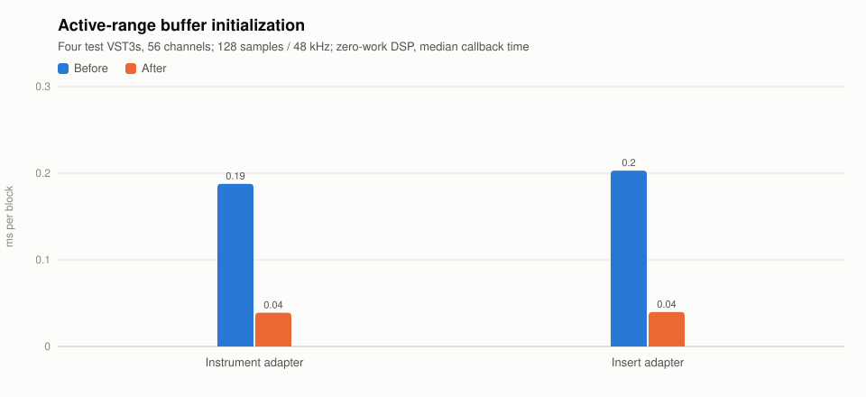

# Active-range buffer benchmark

2026-11-03 · Windows x64 · Ryzen 9 7900X, 12 cores / 24 logical processors.

This follow-up preserves the earlier VST3 render-pool repair. The production change is
two clears: initialize `frames` on every channel instead of all 16,384 reserved frames.
Neither bus layouts nor preparation capacity change.

Four deterministic real VST3s expose 28 stereo outputs (56 channels). At 48 kHz / 128
frames with zero-work DSP, the fixture measures host initialization overhead. It also
writes finite auxiliary data, making leaked sidechain input visible in the main output.
Changing 16/64/128/1024/8192/16384-frame callbacks must remain silent with no input.

| Four-instance adapter | Before median | After median |
| --- | ---: | ---: |
| Instrument | 0.1877 ms | 0.0390 ms |
| Insert effect | 0.2030 ms | 0.0397 ms |

Both changing-size correctness checks pass. The small-vs-large-frame scaling guards fail
before the correction and pass afterward. These are fixture measurements, not Kontakt or
SWAM engine performance figures; 128x fewer samples cleared does not imply 128x faster audio.

[Machine-readable data](benchmark.json).

The user's later-confirmed configuration is **512 samples at 48 kHz**. Saved SWAM profiling
at that configuration measured about 60% before this buffer correction and 59% afterward,
which is too small a change to attribute the reported gap/popping to this issue. The
separate [SWAM helper-sizing investigation](../swam-worker-headroom/benchmark.md) found
the substantial remaining callback-headroom improvement.

Local ignored logs: `buffer-before.log`, `buffer-after.log`, and
`project-512-before-buffer.log` under `src/native/nota.engine/build/`.
Generate the persistent data/plots with
`python .specify/bugs/swam-worker-headroom/benchmark.py` after both profiling follow-ups.
The generator reuses the project's standard-library `scripts/bench-chart.py`.
