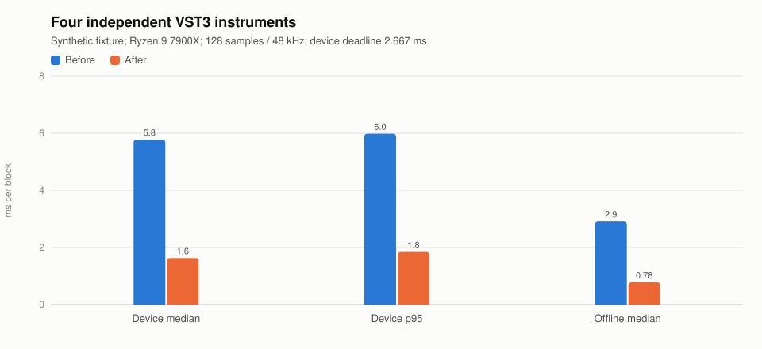
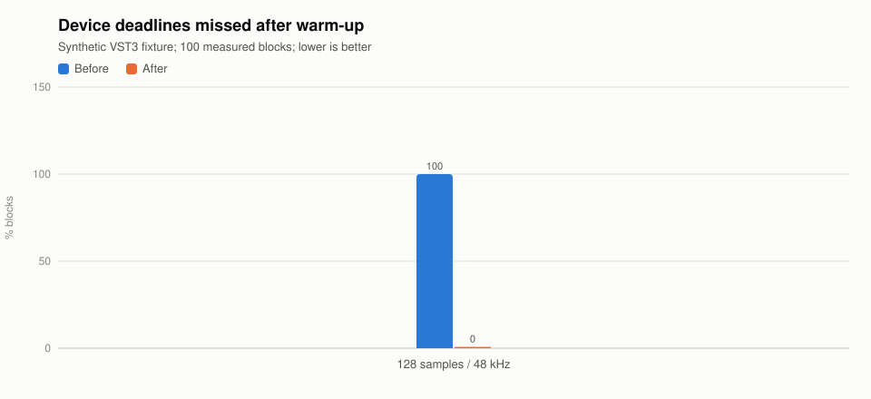

# Hosted VST3 scheduling benchmark

2026-11-03 · Windows x64 · Ryzen 9 7900X (12 cores / 24 logical processors).

Four separately instantiated deterministic **test VST3s**, through the real JUCE adapters
and engine C ABI, with four configured helpers. This is **not a Kontakt or Sample Modeling
Strings benchmark**. Both builds use the same final fixture. The before DLL is the
workspace's native Release binary preserved before changing the scheduling code.

Each measurement has 80 warm-up and 100 measured blocks at 48 kHz / 128 frames: a
**2.6667 ms device deadline**. Device-path measurements use the existing `RenderDeviceBlock`
test hook with pacing between callbacks; they do not open an ASIO/WASAPI device. Offline
and device cases use different fixed DSP work settings. Deadline percentage is calculated
from mean measured callback time, not read from the smoothed/capped UI meter.

| Metric | Before | After |
| --- | ---: | ---: |
| Device callback median | 5.7741 ms | 1.6317 ms |
| Device callback p95 | 5.9836 ms | 1.8457 ms |
| Mean device deadline consumption | 217.59% | 61.57% |
| Late device blocks after warm-up | 100/100 | 0/100 |
| Dedicated helper CPU, 100 device blocks | 0 ms | 500 ms |
| Offline callback median | 2.9141 ms | 0.7791 ms |
| Offline callback p95 | 3.0124 ms | 0.9166 ms |
| Dedicated helper CPU, 100 offline blocks | 0 ms | 187.5 ms |

The device median is approximately 3.54 times faster in this run. Render workers consume
additional cores to meet the deadline; lower callback latency is not a claim of lower
total CPU consumption. The test bounds caller elapsed time plus summed worker CPU, a
conservative work proxy including caller wait time, rather than treating callback wall
time as whole-process CPU. Existing idle/overload/bounce guards also pass.





Machine-readable results: [JSON](benchmark.json), [CSV](benchmark.csv).

## Reproduction

```powershell
cmake --build src/native/nota.engine/build --target nota-render-probe_VST3
dotnet run --project tests/Nota.SmokeTest -c Release -- --hosted-render-pool
```

`NOTA_RENDER_NATIVE_DIR` overrides the native build/fixture directory.
`NOTA_RENDER_REPORT` saves device measurements as JSON. Tests use their own process and
temporary catalog; they neither scan all installed plug-ins nor touch the user's project.

Local evidence under the ignored native build directory:

- `kontakt-render-before-final.log`: test runner against the preserved original DLL;
  six expected failures, including zero instrument/insert helper CPU and late callbacks.
- `kontakt-windows-full.log`: complete after build and smoke gate; includes both fixture
  measurement records and all fourteen hosted checks.
- `kontakt-render-after.log`: focused after checks before the concurrent graph-edit guard.

Generate the persistent charts/results from those two comparable logs with:

```powershell
python .specify/bugs/kontakt-render-overload/benchmark.py `
  src/native/nota.engine/build/kontakt-render-before-final.log `
  src/native/nota.engine/build/kontakt-windows-full.log
```

The generator reuses `scripts/bench-chart.py`; no plotting dependency is added.

## Limits

This is one short local measurement window, not a broad latency guarantee. Windows
scheduling, driver behavior, other processes, real library voices/effects and Kontakt's
internal multiprocessing can change results. The actual user's four Strings patches,
physical output device and buffer/sample rate have not been reproduced. Linux/macOS and
the Linux Valgrind instruction-count gate were not run on this Windows host.
