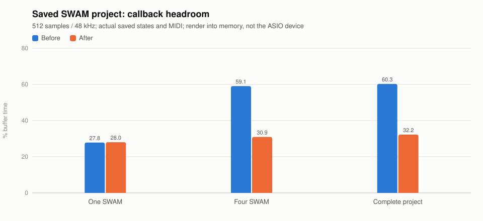

# Saved SWAM project: worker headroom

2026-11-03 · Windows x64 · Ryzen 9 7900X, 12 cores / 24 logical processors.

The user confirmed **512 samples / 48 kHz**, a **10.667 ms deadline**. The diagnostic reads
the supplied saved project, plug-in states and MIDI. It uses a temporary catalog seeded
from installed identifiers and never saves the source bundle. Muting for isolation is
in memory only. All cases seek to the first saved SWAM note at beat 88.932.

After a message-pumped initialization interval and 120 warm-up blocks, each case measures
400 paced callbacks into memory through the production device-path hook. The physical
Yamaha Steinberg ASIO output is not opened. This tests saved MIDI playback, not live-MIDI
latency or the driver's DPC/scheduling behavior. Nonzero RMS confirms rendered audio.

The before build already contains the independent-VST3 pool and active-buffer-clear fixes.
The after build changes only the adaptive active-pool sizing target from 85% to 50% of the
buffer period. Overload activation/exit hysteresis and bounded useful-helper wake-ups remain.

| Saved project case | Before mean budget use | After mean budget use | Before median | After median | Late callbacks |
| --- | ---: | ---: | ---: | ---: | --- |
| One SWAM track | 27.83% | 28.03% | 2.9266 ms | 2.9649 ms | 0/400 in both |
| Four SWAM tracks | 59.06% | 30.92% | 6.2957 ms | 3.2661 ms | 0/400 in both |
| Complete saved mix | 60.25% | 32.22% | 6.4137 ms | 3.4138 ms | 0/400 in both |

The four-track p95 changes from 6.6926 ms to 3.7011 ms. Complete-project p95 changes from
6.8129 ms to 3.8290 ms. The complete mix contains four Kontakt and four SWAM tracks, two
built-ins and return effects; other tracks' clips do not all overlap this SWAM region.



[Raw measurement records](benchmark.json).

## CPU tradeoff and useful-helper limit

For the four-SWAM case, caller elapsed plus worker CPU changes from 4,926 ms to 5,163 ms
across 400 callbacks: approximately **4.8% more of this conservative render-work proxy**
for roughly half the callback wall time. This proxy includes caller wait time and is not
a precise whole-process CPU counter.

An additional all-workers offline scheduling comparison finished at about 33% but used
6,676 ms of the same proxy. It can wake the whole 16-thread pool for only four expensive
jobs. The production correction instead wakes the bounded useful helper count. The final
four-track production proxy is about 23% lower than that initial all-workers comparison,
with similar or better callback latency in these local runs.

The deterministic 512-frame VST3 guard independently fails before (four jobs 6.086 ms vs
one 2.916 ms) and passes after (four 3.161 ms vs one 2.918 ms). It also enforces a bounded
caller/worker work proxy; existing light-load/idle/bounce/overload guards remain required.

## Reproduce

```powershell
dotnet run --project tests/Nota.SmokeTest -c Release -- `
  --profile-project 'D:/Projects/Untitled.nota' 512 48000
python .specify/bugs/swam-worker-headroom/benchmark.py
```

`--profile-project` is opt-in; the commercial project/profile is not part of the normal
smoke suite. Optional mode selects `one-swam`, `four-swam`, `complete-project` or
`four-swam-all-workers`. The fixture guard is in `--hosted-render-pool` and `--perf`.

Ignored local logs: `project-512-after.log` (buffer fixed, old helper target),
`project-512-final.log` (new target), `project-512-all-workers.log` (initial diagnostic
comparison), `headroom-before.log`, `headroom-after.log` under the native build directory.

The source project manifest's SHA-256 before and after is
`F95E30CF1E5849EA3EDAB0407BA4BF6E687E68767B14ED91E0368BDED02D95A7`.
No source music, presets or plug-in state blobs are copied into this repository.

## Limits

The original audible popping was not reproduced in these in-memory 400-block windows,
including before the target change. Physical ASIO audition remains required. Studio One
was not instrumented and its meter/internal buffering was not measured. SWAM's performance
and humanization can vary between runs; results are local observations, not universal CPU
or dropout guarantees. macOS/Linux and their instruction-count performance gate were not run.
