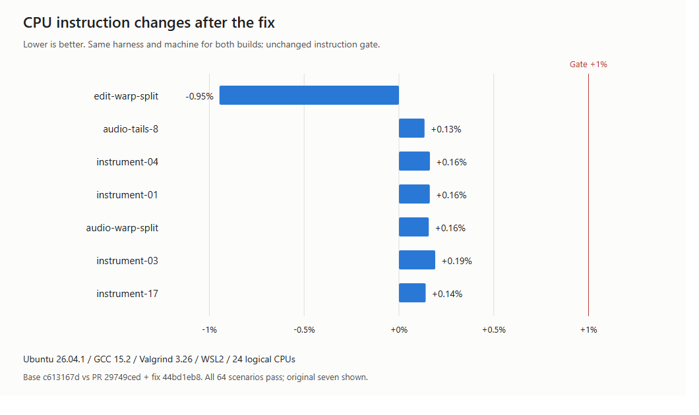
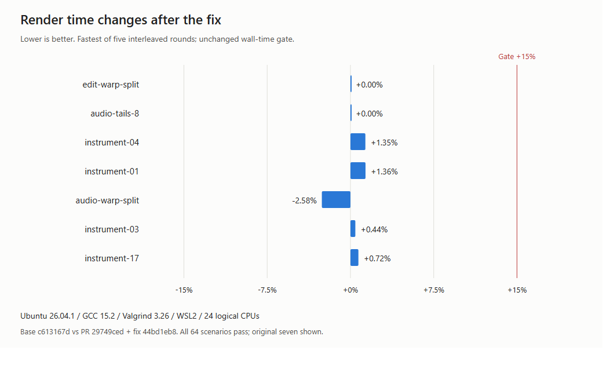

# Tempo track performance-gate fix

Base: `c613167d`. PR: `29749ced` plus fix `44bd1eb8`. Ubuntu 26.04.1 / GCC 15.2 / Valgrind 3.26.0 / WSL2 / 24 logical CPUs.

The unchanged `scripts/perf-gate.sh c613167d6f66b04e40e7e8c4f656797c8091b2bc` exits 0. All 64 scenarios pass the 1% instruction and 15% wall-time limits. Timing uses five interleaved rounds.

The original PR CI run failed seven instruction scenarios. The table below compares the patched PR with the same base locally; it is not a timing comparison across machines.

| Scenario | Base instructions | Fixed instructions | Work change | Base wall | Fixed wall |
|---|---:|---:|---:|---:|---:|
| `edit-warp-split` | 142,686 | 141,335 | -0.95% | 0.001 ms/edit | 0.001 ms/edit |
| `audio-tails-8` | 4,135,535 | 4,141,115 | +0.13% | 0.142 ms/audio-s | 0.142 ms/audio-s |
| `instrument-04` | 6,365,571 | 6,375,969 | +0.16% | 0.223 ms/audio-s | 0.226 ms/audio-s |
| `instrument-01` | 6,369,180 | 6,379,542 | +0.16% | 0.221 ms/audio-s | 0.224 ms/audio-s |
| `audio-warp-split` | 6,718,517 | 6,729,083 | +0.16% | 0.233 ms/audio-s | 0.227 ms/audio-s |
| `instrument-03` | 6,410,057 | 6,422,324 | +0.19% | 0.227 ms/audio-s | 0.228 ms/audio-s |
| `instrument-17` | 7,387,219 | 7,397,625 | +0.14% | 0.279 ms/audio-s | 0.281 ms/audio-s |

[Complete report](report.md). Raw work and timing TSVs and environment details are alongside this summary. Thresholds, measurement scenarios, and the regression-acceptance label were unchanged.
