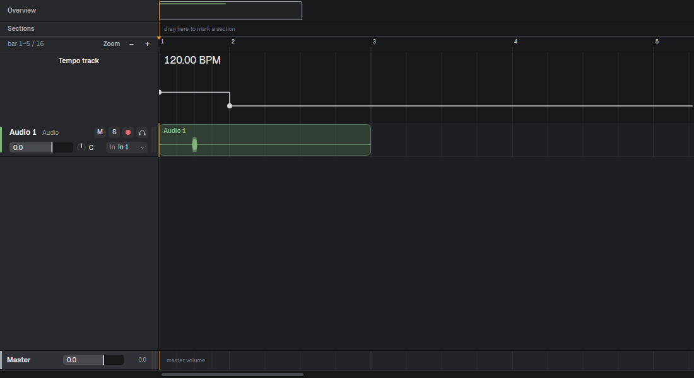
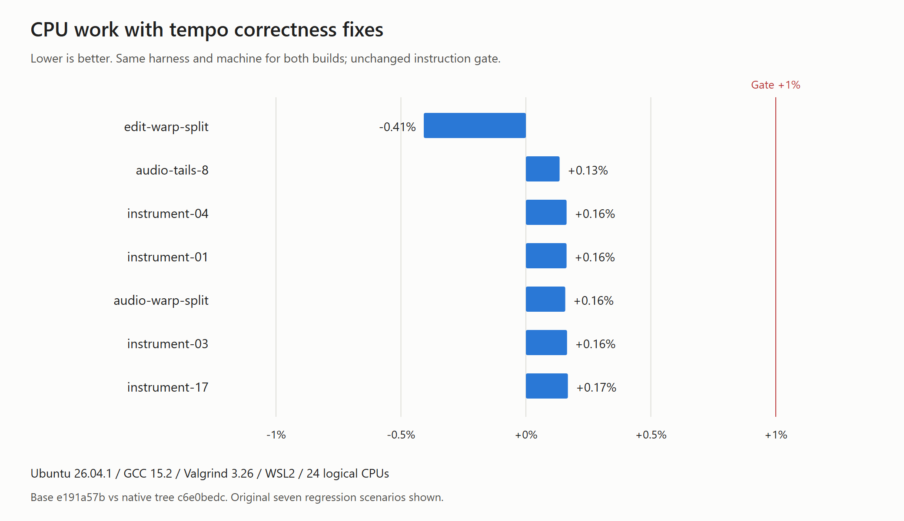
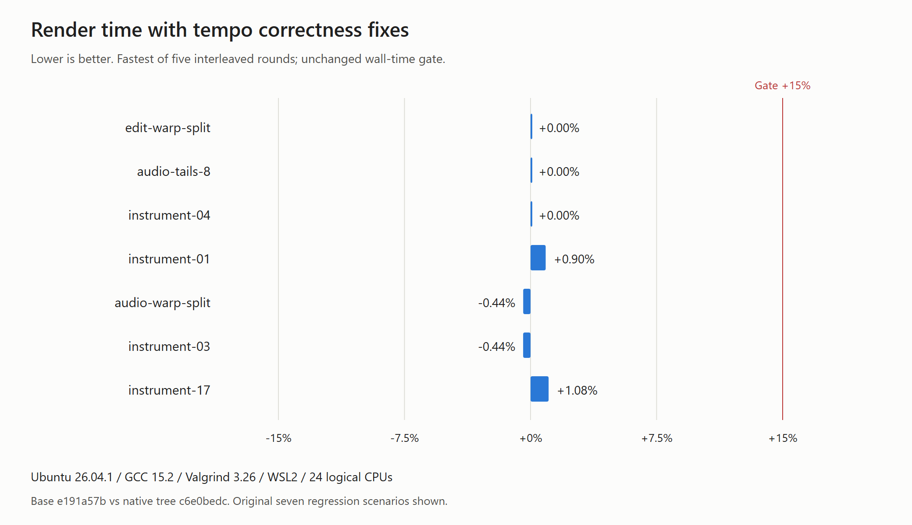

# Tempo-map correctness verification

The fixes cover mapped editing, loop capture and comps, lane BPM refresh, frozen
playback and persistence, range-bounce sizing, fractional bar grids and warped waveform
placement. These restore the documented behavior of issue #535.

## Local validation

- Windows Release `scripts/build-win.ps1`: passes, including `SMOKE TEST PASSED`,
  scanner self-tests, render-pool CPU guards and `SCAN SCALE PASSED`.
- Focused tempo smoke: 63 checks pass, including mapped capture/edit/freeze/range-bounce regressions.
- Tempo UI: 40 checks pass; the previous PR head fails the four BPM/grid checks and
  all eight waveform checks. Both screenshots use the same source, map, 1100x600
  window and default Studio Dark theme. Before: 420649a6 (same native tree as 44bd1eb8).
- Linux unchanged performance gate: all 64 scenarios pass the 1% CPU instruction and
  15% wall-time limits, with five interleaved timing rounds and standard confirmation
  rounds when needed. No threshold, scenario or acceptance override changed.
- Base: develop e191a57bfc6f3390b3a24d616f57aadda41d0c1c. Final source commit: `7b65ef7`. Tested head native subtree:
  c6e0bedc00387ed4d08eb391e8890fabeffe35f8. The Linux and Windows native trees match exactly.
- Linux source: 420649a6 plus `fix.patch` (tracked correctness fixes and develop merge).
  The patch SHA-256 is 5c1b8eac81d0285aadd059ac6a0f34a3e492d1e2986f76efdaaae73df1d7feb7. Reports
  label the original checkout HEAD; use the native tree hash to identify the measured code.
- Machine: Ryzen 9 7900X, 24 logical CPUs; Ubuntu 26.04.1 / WSL2, GCC 15.2.0,
  Valgrind 3.26.0. Both builds ran on this machine; hosted CI uses different runners.

[Complete gate report](report.md), [raw measurements](results.csv),
[environment](environment.txt), [UI before](ui-before.log), [UI after](ui-after.log),
[focused tempo smoke](tempo-smoke.log).

Reproduction: `bash scripts/perf-gate.sh e191a57bfc6f3390b3a24d616f57aadda41d0c1c`
in a Linux checkout of the final PR source. The local run reuses the exact pinned CPM
sources through a toolchain and CPM source overrides to avoid downloading them again.

No physical audio device was used; recording coverage exercises the real capture ring
through the engine's device-free self-tests. See the PR checks for hosted platform results.
