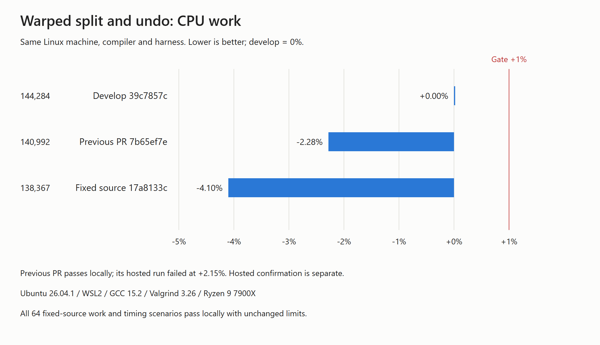
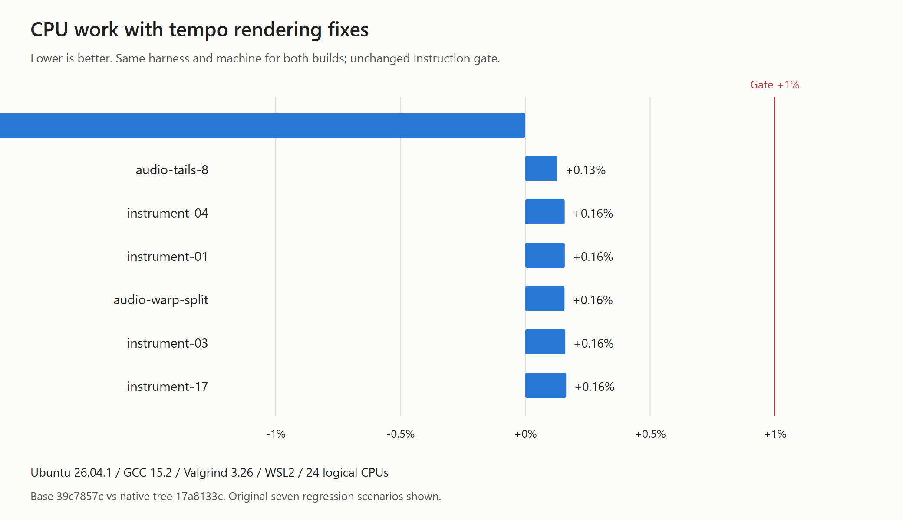
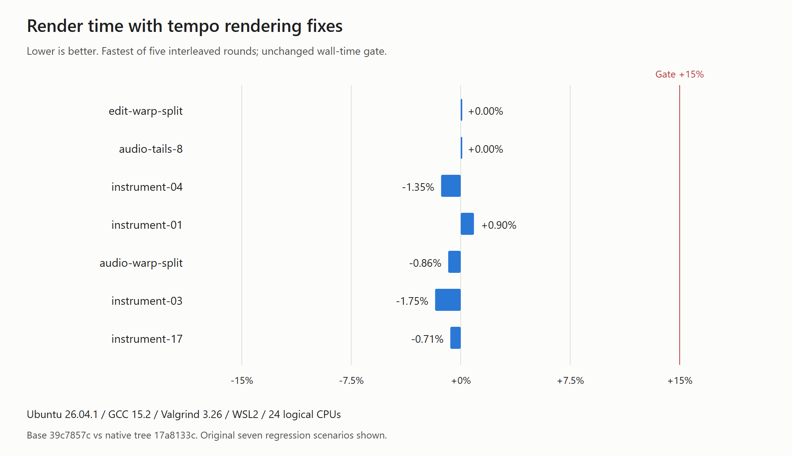

# Tempo-map rendering follow-up

Fix source: 5762052; merged source: 91c01299 (develop 39c7857c). Native subtree:
`17a8133cb04e169554232b4b1bf90e655fa8a95d`. Linux and Windows tested that exact native tree.

Three Greptile findings are fixed: reverse source/beat positions before mapped stretching,
consolidate with mapped endpoints and an independent clock, and use mapped clip endings
for natural-rate release fades. Warped cache reuse compares borrowed identity before
creating its final owned marker vector.

## Validation

- Initial audio reproductions fail on the preceding source; the fixes pass all 101 focused
  tempo checks, including 38 new rendering checks.
- Full Windows Release build/smoke/scanner/CPU guards and 40 tempo UI checks pass before
  and after the develop merge. No physical audio device was used.
- The unchanged Linux gate passes all 64 scenarios at the existing 1% instruction and
  15% wall-time limits, with five interleaved timing rounds and no acceptance override.
- Same-machine split work: develop 144,284, previous PR 140,992, fixed 138,367 instructions.
  Fixed work is -4.10% vs develop and -1.86% vs the preceding PR.
- The prior hosted job 131248636073 measured 139432 / 142433 (+2.15%) and failed. The prior
  local result passed; no hosted pass is inferred from these local measurements. The new
  published source requires its own green hosted run.
- See `hosted-verification.md` for the final hosted result once available, or the PR's checks.

[Full local gate](report.md), [split raw data](split-work.csv), [environment](environment.txt),
[focused smoke](tempo-smoke.log), [UI checks](tempo-ui.log).

Reproduce with `scripts/perf-gate.sh 39c7857c3c11ab44a5dd77e500acce26e9661312` on Linux.
The local runner reused the exact pinned CPM sources. Its checkout label is 7b65ef7e plus
the fix patch; identify the actual measured code by the native subtree above, rather than
the original checkout label in the raw report. Develop 39c7857c and e191a57b have identical
native/performance sources.
