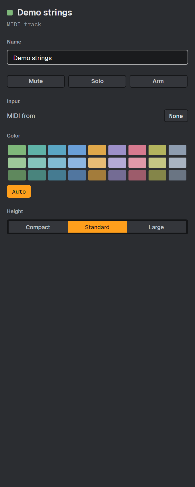
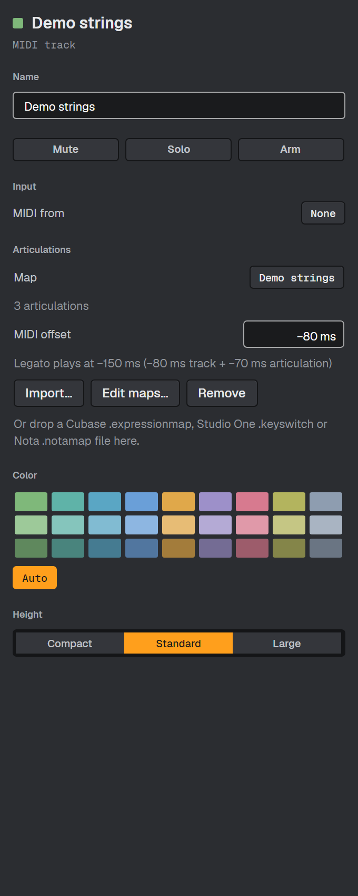
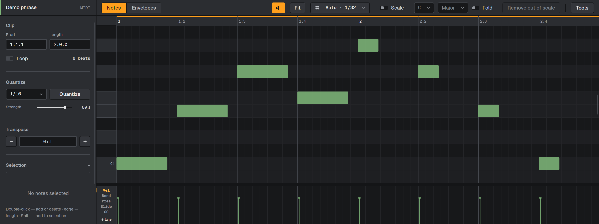
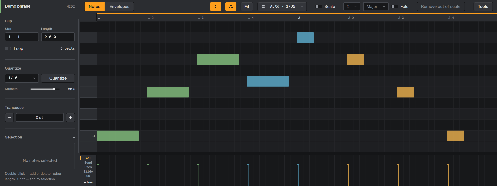
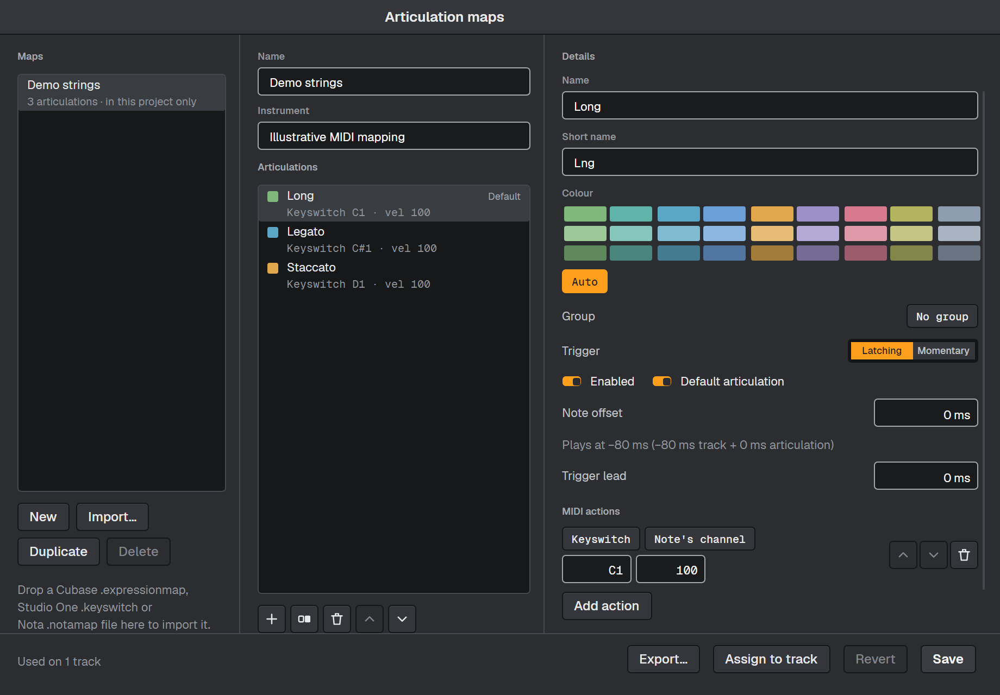
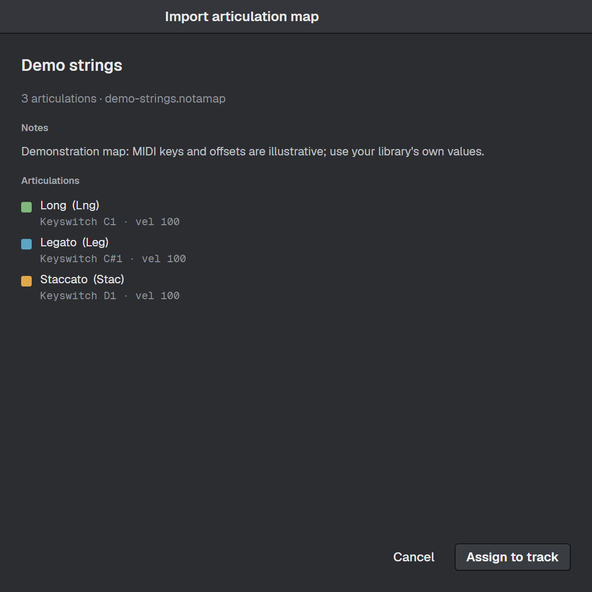

# Articulation-map UI evidence

Real Avalonia controls captured with the headless Skia method from `nota-docs/shots/app`.
Studio Dark, 2× layout/rendering, no operating-system window frame; isolated `NOTA_DATA_DIR`.
The before UI is compiled from `ad5b1c6f`; the after UI from `6c876cf5`. Each pair has the same
dimensions, track name and note geometry. Musical notes are populated directly in the managed
piano roll. The base harness uses the current DLL only for unchanged track metadata calls;
it does not send old-layout note structs through the changed C ABI. These captures prove UI
appearance; they are not a hosted-instrument audio test.

| View | Before | After |
|---|---|---|
| Track inspector (340 × 850 logical px) |  |  |
| Piano roll (1440 × 540 logical px) |  |  |




The manager and preview are new windows and have no base equivalent. The demo map is synthetic:
Long, Legato and Staccato with example keys and offsets, not vendor data or measured latency.
The map remains project-local. No settings, projects, plug-in catalog or sample files from the
user's normal data directory are used.

## Reproduce

`Program.cs` and `Capture.csproj` are included beside the images. Build each UI revision in its
own source directory. Set `NOTA_DATA_DIR` to a new scratch directory, then run on Windows:

```powershell
dotnet run --project ./Capture.csproj -c Release -p:After=false -p:NotaRepo=<base-source> -p:NotaNativeDir=<current-native-build> -- <before-images>
dotnet run --project ./Capture.csproj -c Release -p:After=true -p:NotaRepo=<pr-source> -- <after-images>
```

The attached manual patch includes the same deterministic scene in the regular docs harness.
From a manual checkout with the patch applied and `NOTA_REPO` pointing to the PR checkout:

```sh
npm ci
npm run shots -- editing/articulation-maps
npm run build
npm run check
```

This captures the inspector, piano roll and manager for the EN/RU manual. The paired PR images
above remain PNG assets on `pr-assets`, outside the engine/application source branch.

Manual base: `nota-daw/nota-docs` develop `05732b0`.
Prepared manual commit: `45178219b8962d167aeee2560d997870cb9740f1`.
`nota-docs.patch` includes the page sources, related-page links, screenshot scene, captures,
coverage and manifest entries, and Windows path/CRLF normalization for the docs checker.
It is attached for upstream integration; the published manual site has not been changed.
