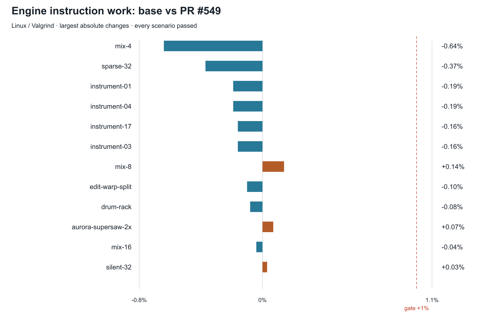
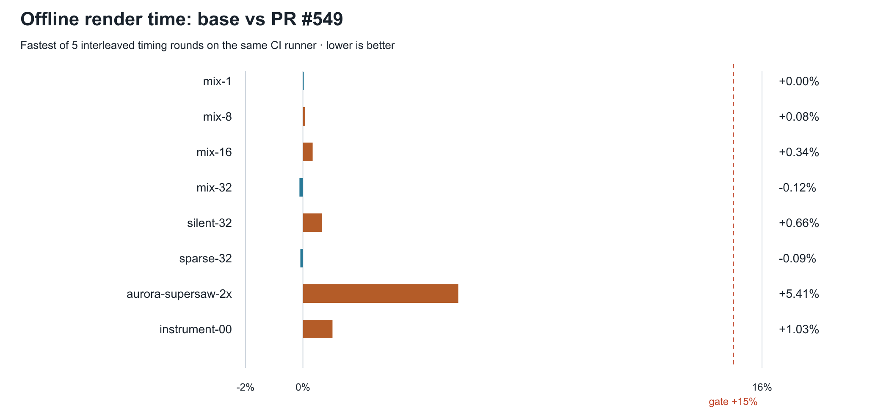
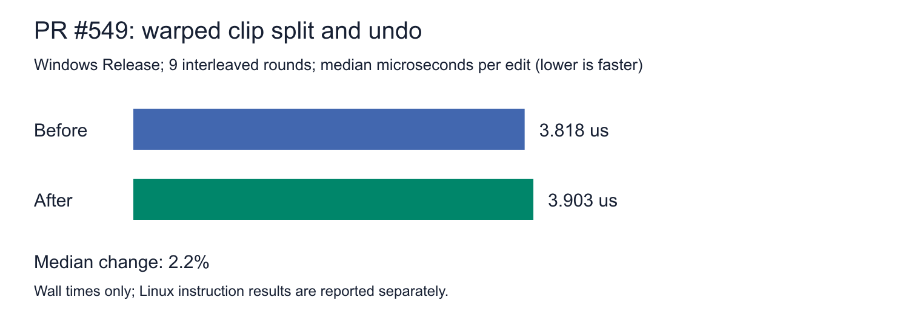

# PR #549: benchmark evidence

Measured PR source: `6c876cf54c1665dba62a97bb92985ef1b6e36e65`.
Base: `ad5b1c6f5853665a52f91e4d244c553f5a007231`.
CI integration merge measured by the harness: `6495e5cd`.

Source: [Performance run 42629193021](https://github.com/nota-daw/nota/actions/runs/42629193021).
Every one of the 63 engine scenarios passes; idle-CPU guards also pass on Windows, macOS and Linux.
Thresholds are unchanged: at most +1% instructions and +15% confirmed render time per scenario.

## Method and machine

GitHub-hosted Linux runner, Ubuntu 26.04 image, four logical CPUs; Release engine, GCC 15.2.0,
Valgrind/Callgrind. The workflow did not record the physical CPU model. Instruction counts
cover all engine threads; effect comparisons subtract the instrument baseline as the canonical
report describes. Render timing is the fastest of five interleaved base/PR rounds. These CI
measurements establish regressions against the base, not the cost of a densely mapped library.

Reproduce on Linux with the build dependencies in `.github/workflows/perf.yml`:

```sh
PERF_ROUNDS=5 bash scripts/perf-gate.sh ad5b1c6f 6c876cf5
```




Selected rows from the complete attached `report.md` (all regressions are retained there):

| Scenario | Work base | Work PR | Change | Render base | Render PR |
|---|---:|---:|---:|---:|---:|
| mix-8 | 878.32 M | 879.56 M | +0.14% | 25.38 ms | 25.40 ms |
| aurora-supersaw-2x | 696.62 M | 697.10 M | +0.07% | 24.75 ms | 26.09 ms |
| silent-32 | 621.93 M | 622.14 M | +0.03% | 21.15 ms | 21.29 ms |
| mix-32 | 3500.25 M | 3500.43 M | +0.01% | 99.42 ms | 99.30 ms |
| mix-4 | 444.76 M | 441.92 M | −0.64% | 12.90 ms | 12.97 ms |
| edit-warp-split | 0.13 M | 0.13 M | −0.10% | rounded to 0.00 ms | rounded to 0.00 ms |

Work is instructions per scenario; render time is milliseconds per second of rendered audio,
except edit-warp-split (milliseconds per edit). Use the original TSVs for exact raw instruction
counts. The human-readable report applies the canonical effect-baseline calculation.

## Regression fix and previous good build

The split/undo regression was +4.59% instructions on `8abb3ad1`
([failed run](https://github.com/nota-daw/nota/actions/runs/42622338564)). It was +0.45% after
the clone-allocation fix ([run 42627356463](https://github.com/nota-daw/nota/actions/runs/42627356463));
the latest run above is −0.10%. Each result is a separate run against its own `develop` base;
do not treat differences between runners as a controlled timing comparison. The latest run
includes the actual base/PR comparison in one job.

For the controlled Windows timing comparison, `8abb3ad1` (before) and `bc131d63` (after) were
Release/MSVC 14.44 builds on AMD Ryzen 9 7900X, 24 logical CPUs, Windows 10.0.26300.
The identical executable performed 1000 cycles of eight warped splits and eight undos,
with split fades disabled, over nine alternating-order rounds. CSV and chart are attached.

| Revision | Median µs/edit | Minimum | Maximum |
|---|---:|---:|---:|
| Before | 3.818 | 3.731 | 4.525 |
| After | 3.903 | 3.740 | 4.345 |

The +2.2% median wall-time difference has overlapping ranges; no Windows timing speedup is
claimed. The preceding good build `96733e0e` also passed the instruction gate
([run 42617643537](https://github.com/nota-daw/nota/actions/runs/42617643537)).



The earlier author-reported mapped-track timing in the PR history has no raw data attached
and is not promoted to a verified chart here. A controlled mapped-versus-unmapped library
benchmark remains open under T072. Native regression check 38 fails on the old muted-release
behaviour and passes with the fix; the full smoke suite includes the render-pool guards.
