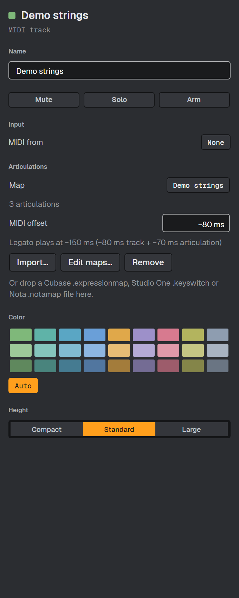
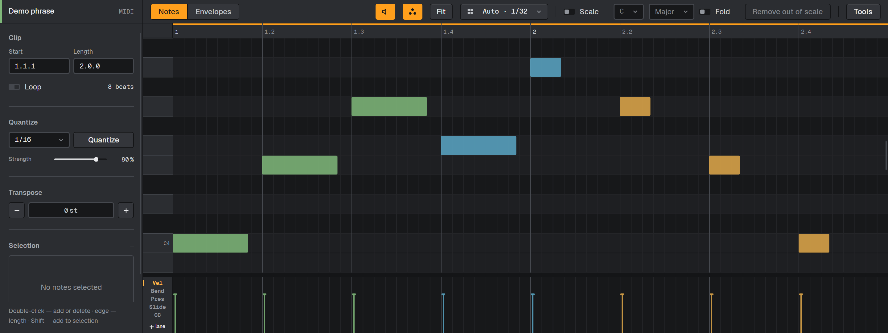
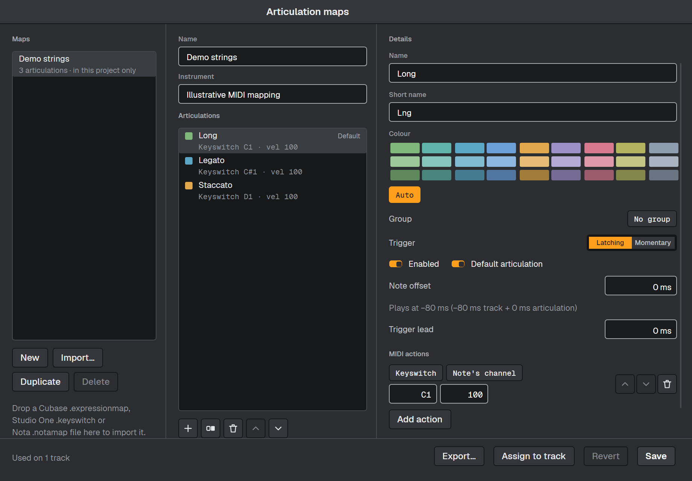

# Articulation maps

An articulation map names a sample library's playing techniques, such as Long, Legato and
Staccato, and stores the MIDI messages that select them. Put a map on an instrument track,
then choose an articulation for each note in the piano roll.

Articulation switching is sent to hosted plug-ins and racks containing a hosted plug-in.
Built-in instruments do not receive articulation messages. Load the matching library and
patch yourself: importing a map does not load an instrument.

## Import and assign a map

1. Select the instrument track and open the browser's **Track inspector** tab.
2. Under **Articulations**, choose **Import…**, or drop a map file on that section.
3. Read the preview, especially its warnings, then choose **Assign to track**.

Nota reads Cubase `.expressionmap`, Studio One `.keyswitch` and Nota `.notamap` files by
their contents. Studio One `.soundvariation` files are unsupported: export a `.keyswitch`
list instead. The original file stays unchanged. Unsupported actions and missing information
are reported in the preview; check the result against your library's documentation.

Studio One keyswitch lists cannot describe every controller action. Use the Cubase map or
add the missing controller in the manager when a preview warns about an unknown action.
Imported switch modes default to **Latching** when the format does not store a mode.

## Set a note's articulation

Open a MIDI clip, select notes, then right-click a note and choose **Articulation**.
The choice applies to selected notes on that track as one undo step. Clearing the choice
uses the map's default articulation, if set. Notes whose articulation was removed or disabled
keep their stored IDs, play the default and display a warning mark.

The palette chip beside the audition button in the clip-editor header switches between
track colours and articulation colours. It starts off and the preference is saved.

## Compensate for the library's attack

Set the track's **MIDI offset** in the inspector, from −2000 to +2000 ms.
In the manager, **Note offset** adds an articulation-specific offset in the same range.
Negative values play earlier; positive values play later. Notes remain on the editor's grid.

| Example | Track MIDI offset | Articulation note offset | Effective playback offset |
|---|---:|---:|---:|
| Long | −80 ms | 0 ms | −80 ms |
| Legato | −80 ms | −70 ms | −150 ms |

These values are examples, not measured presets. Use values that suit your library.
The inspector and manager show the combined result. **Trigger lead** (0–2000 ms) sends
the articulation's messages before the shifted note without shifting the note again.

Playback cannot send a note before playback starts or before a loop wraps. A negative
offset on a note at a loop start therefore cannot be fully compensated on each repeat.
Automatic attack measurement and saved offset presets are not available.

## Create and edit maps

Open **View → Articulation maps…**, use **Edit maps…** in the inspector, or find the command
in the command palette. Choose **New**, **Import…** or **Duplicate**, then edit the map and
its articulations. Each articulation has a name, colour, enabled/default state, trigger mode,
offset, lead and ordered MIDI actions. Existing imported groups can be selected; creating
or renaming groups is not available.

**Latching** selects a technique until another replaces it; a keyswitch is released after
20 ms. **Momentary** holds the switch with the note. Actions support keyswitches, controllers,
program change and bank MSB/LSB, on **Note's channel** or an explicit channel (1–16).
Actions send in their listed order: put bank MSB/LSB before program change when required.

In an Instrument Rack, keyswitch notes follow the rack's key/velocity zones and chain MIDI
effects, and reach the chain on channel 1. Host the plug-in directly on the track when those
limits would prevent your map from selecting the intended articulation.

Choose **Save** to update every track using that map as one undo group; the footer reports
how many tracks changed. **Revert** discards the working edits. **Assign to track** uses the
currently selected track; **Export…** writes a Nota `.notamap` file. Duplicate the map before
editing if other tracks should keep using the original.

Projects save their own maps, offsets and note assignments, so they open without the local
map library. If a project's map differs from the library copy, the manager shows the project's
version and labels the difference. Saving that version also updates the library.

Articulations work in Arrangement and Session playback, seeking, looping and offline export.
The articulation lane is not part of this version; use the note menu to assign techniques.
