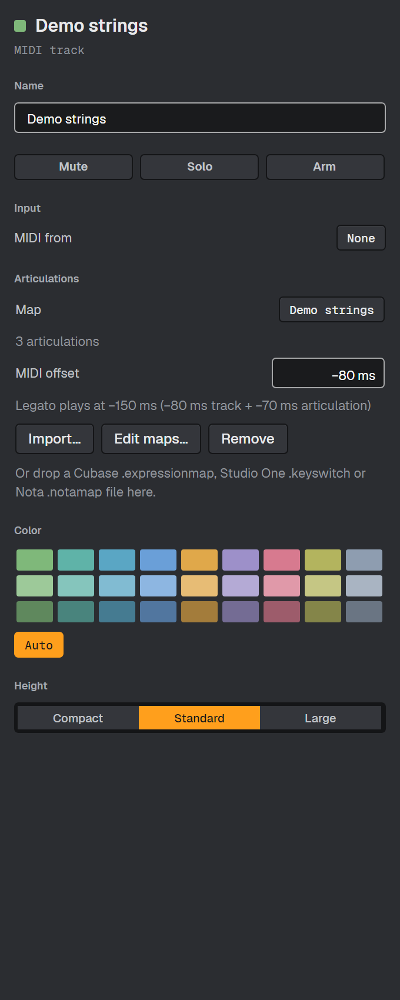
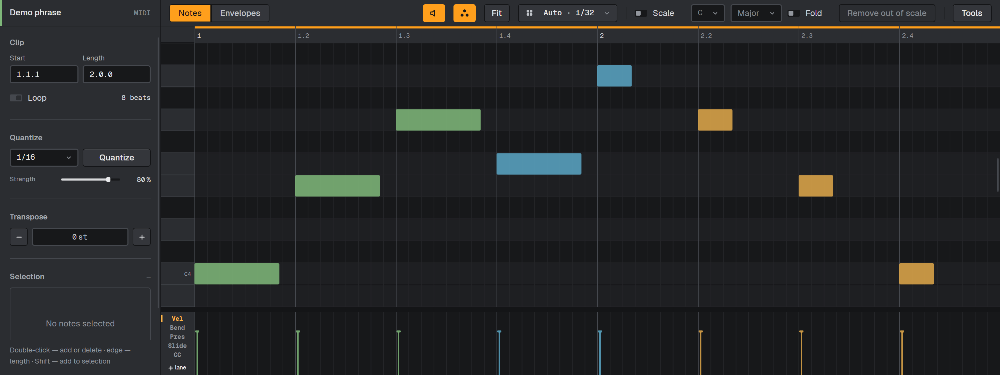
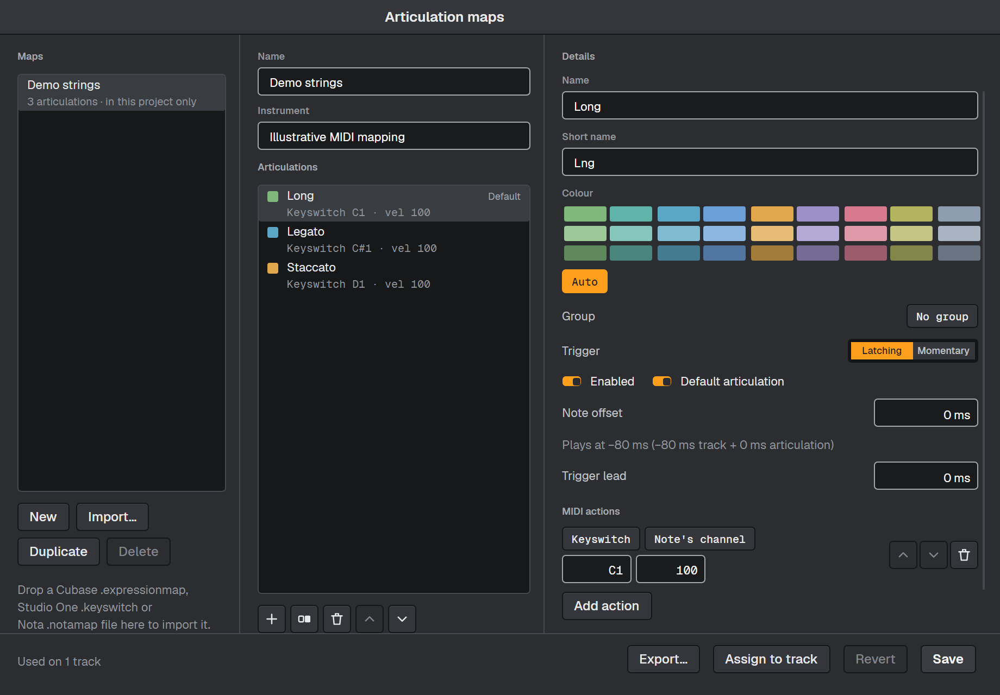

# Карты артикуляций

Карта артикуляций хранит названия приёмов игры — например, Long, Legato и Staccato —
и MIDI-сообщения для их переключения. Назначьте карту инструментальному треку,
а затем выберите артикуляцию для каждой ноты в piano roll.

Сообщения переключения получают загруженные плагины и рэки с плагином внутри.
Встроенные инструменты их не получают. Нужную библиотеку и патч загрузите сами:
импорт карты не загружает инструмент.

## Импорт и назначение карты

1. Выберите инструментальный трек и откройте вкладку **Track inspector** в браузере.
2. В разделе **Articulations** нажмите **Import…** или перетащите туда файл карты.
3. Прочитайте предварительный просмотр и предупреждения, затем нажмите **Assign to track**.

Nota определяет формат по содержимому: поддерживаются Cubase `.expressionmap`,
Studio One `.keyswitch` и Nota `.notamap`. Формат Studio One `.soundvariation` пока
не поддерживается — экспортируйте список `.keyswitch`. Исходный файл не меняется.
В предварительном просмотре перечислены неподдерживаемые действия и недостающие
данные; сверяйте результат с документацией библиотеки.

Списки Studio One не описывают все действия с контроллерами. Если появилось
предупреждение о неизвестном действии, используйте карту Cubase или добавьте
нужный контроллер в менеджере. Если формат не хранит режим переключения,
артикуляции импортируются в режиме **Latching**.

## Выбор артикуляции ноты

Откройте MIDI-клип, выделите ноты и выберите **Articulation** в контекстном меню ноты.
Выбор применяется к выделенным нотам этого трека одним шагом отмены. Сброс выбора
возвращает артикуляцию по умолчанию, если она задана. Если артикуляция удалена или
отключена, ноты сохраняют её идентификатор, играют артикуляцию по умолчанию
и показывают предупреждающую метку.

Кнопка с палитрой рядом с прослушиванием в заголовке редактора переключает окраску
нот с цвета трека на цвета артикуляций. Изначально она выключена; настройка сохраняется.

## Компенсация атаки библиотеки

В инспекторе задайте **MIDI offset** трека в пределах от −2000 до +2000 мс.
В менеджере **Note offset** добавляет смещение конкретной артикуляции в том же диапазоне.
Отрицательные значения запускают ноты раньше, положительные — позже. На сетке ноты
остаются на своих местах.

| Пример | MIDI offset трека | Note offset артикуляции | Итоговое смещение |
|---|---:|---:|---:|
| Long | −80 мс | 0 мс | −80 мс |
| Legato | −80 мс | −70 мс | −150 мс |

Это примеры, а не измеренные пресеты: подберите значения для своей библиотеки.
Инспектор и менеджер показывают сумму. **Trigger lead** (0–2000 мс) отправляет сообщения
артикуляции до смещённой ноты, не сдвигая саму ноту повторно.

Ноту нельзя отправить до запуска воспроизведения или до перехода к началу петли.
Поэтому отрицательное смещение ноты в самом начале петли не компенсируется полностью
при каждом повторе. Автоматического измерения атаки и сохранённых пресетов смещения пока нет.

## Создание и редактирование карт

Откройте **View → Articulation maps…**, нажмите **Edit maps…** в инспекторе или найдите
команду в палитре. Выберите **New**, **Import…** или **Duplicate**, затем отредактируйте
карту и её артикуляции. У каждой артикуляции есть имя, цвет, состояния enabled/default,
режим переключения, смещение, опережение и упорядоченные MIDI-действия. Можно выбрать
существующую импортированную группу; создавать и переименовывать группы пока нельзя.

**Latching** выбирает приём до следующего переключения; клавиша keyswitch отпускается
через 20 мс. **Momentary** удерживает переключатель вместе с нотой. Доступны keyswitch,
контроллеры, program change и bank MSB/LSB. Сообщения идут на **Note's channel** или
явно выбранный канал (1–16), в порядке списка. Если библиотеке требуется выбор банка
до программы, расположите bank MSB/LSB перед program change.

В Instrument Rack ноты keyswitch проходят через зоны клавиш/velocity и MIDI-эффекты
цепочек, а в цепочку поступают на канале 1. Если это мешает карте выбирать нужный приём,
разместите плагин непосредственно на треке.

**Save** обновляет все треки с этой картой одной группой отмены; число обновлённых
треков видно внизу. **Revert** отменяет несохранённые правки. **Assign to track** назначает
карту выбранному треку, **Export…** сохраняет файл Nota `.notamap`. Чтобы другие треки
продолжали использовать исходную карту, сначала создайте копию через **Duplicate**.

Проект хранит собственные карты, смещения и назначения нот, поэтому открывается без
локальной библиотеки карт. Если карта проекта отличается от библиотечной, менеджер
показывает версию проекта с соответствующей пометкой. Её сохранение обновит и библиотеку.

Артикуляции работают в Arrangement и Session, при перемотке, зацикливании и офлайн-экспорте.
Отдельной дорожки артикуляций в этой версии нет — назначайте приёмы через меню нот.
